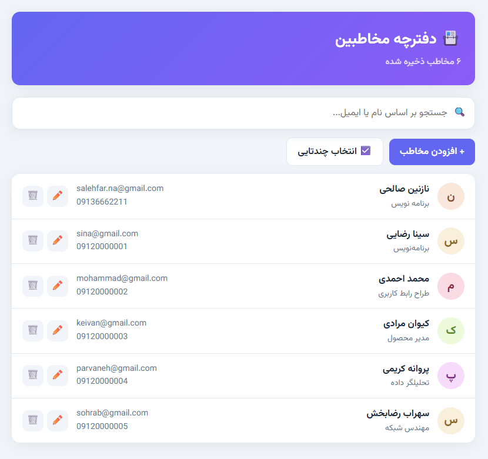
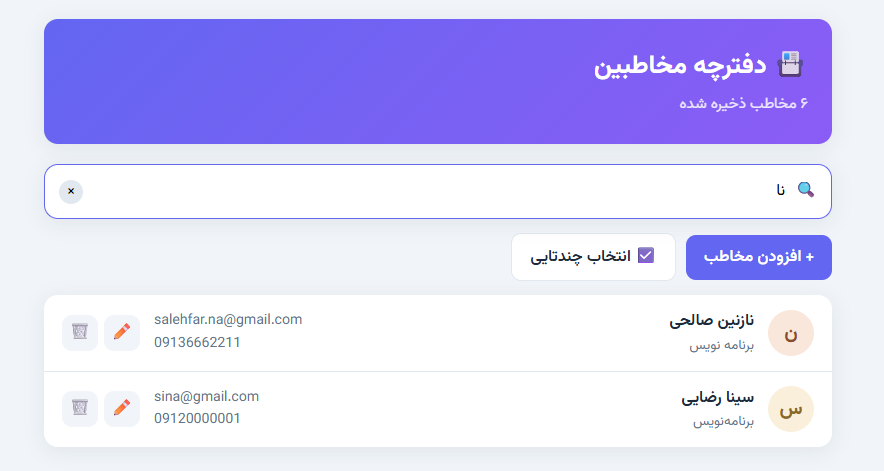
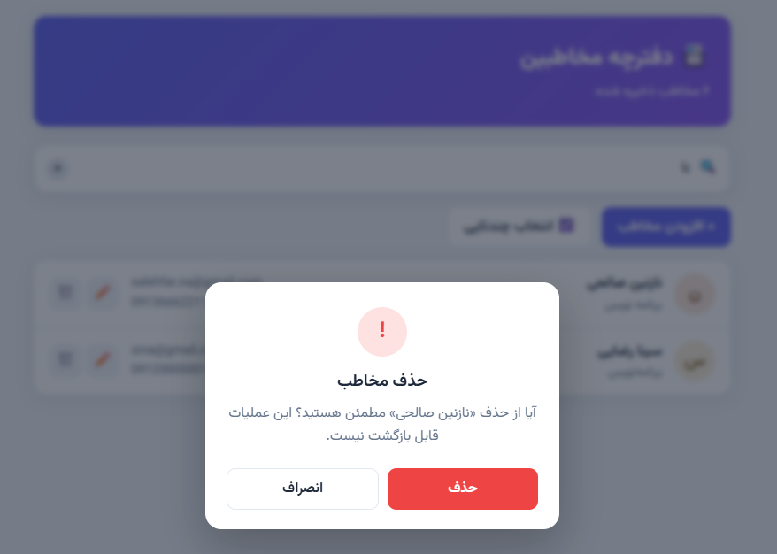

# 📇 Contact App

A contact management app built with **React** and **plain CSS**, with no external packages. Users can add, edit, delete and search contacts, with form validation and confirmation modals for every action.

## ✨ Features

- ➕ Add a new contact with form validation
- ✏️ Edit an existing contact
- 🗑️ Delete a contact
- ☑️ Select multiple contacts and delete them in bulk
- 🔍 Search contacts by name or email
- ✅ Validation for name, email, job and phone number (including duplicate email check)
- 💬 Confirmation modal before every action (add, edit, delete, bulk delete)
- 🔔 Toast notifications after each successful action
- 💾 Contacts are saved in `localStorage`, so they stay after a page refresh
- 🌐 RTL layout with Persian (Farsi) UI
- 📱 Responsive design

## 📸 Screenshots

### Contact list

The main page shows all contacts with search, add and multi-select buttons.



### Search

Contacts can be filtered instantly by name or email.



### Confirmation modal

Every action (add, edit, delete, bulk delete) needs the user's confirmation.



## 🛠️ Built With

- React (Vite)
- Hooks: `useState`, `useEffect`
- Plain CSS (no UI libraries)

## 🚀 Getting Started

```bash
# 1. Clone the repository
git clone https://github.com/NazaninSalehfar/contact-app.git

# 2. Go to the project folder
cd contact-app

# 3. Install dependencies
npm install

# 4. Start the development server
npm run dev
```

Then open `http://localhost:5173` in your browser.

## 📁 Project Structure

```
src/
├── components/
│   ├── ContactForm.jsx    # Add / edit form with validation
│   ├── ContactItem.jsx    # A single contact row
│   ├── ContactList.jsx    # List of contacts
│   ├── Modal.jsx          # Confirmation modal
│   ├── SearchBar.jsx      # Search input
│   ├── Toast.jsx          # Success notification
│   └── Toolbar.jsx        # Add, select and bulk delete buttons
├── data/
│   └── initialContacts.js # Initial sample data
├── utils/
│   └── validators.js      # Form validation rules
├── App.jsx                # Main component and app state
└── App.css                # Styles
```

## 👩‍💻 Author

**Nazanin Salehfar**
GitHub: [@NazaninSalehfar](https://github.com/NazaninSalehfar)
